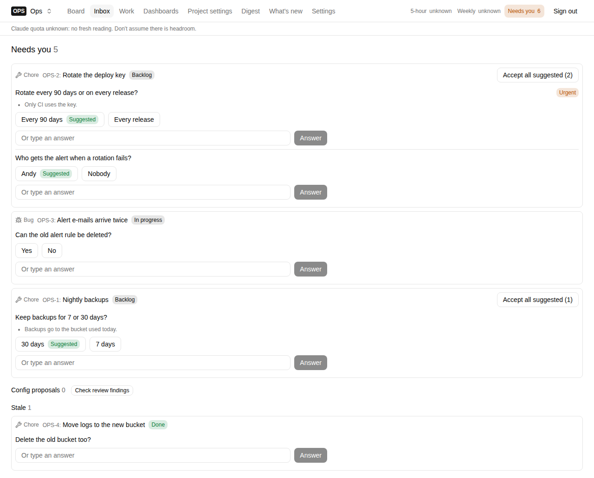
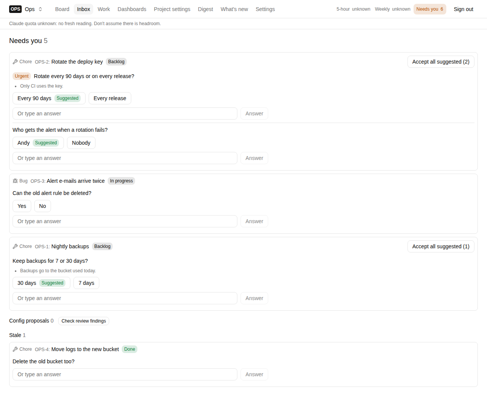
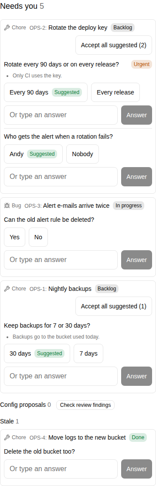
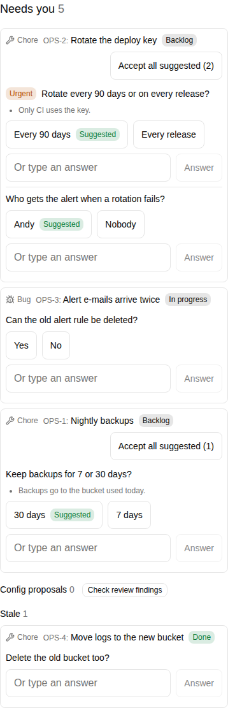

# 2026-11-21 — AI-126: M4.13: Hallmark trial on the Needs-you inbox

Hallmark is a third-party design skill (MIT, `github.com/Nutlope/hallmark`, v2.0.0, read 2026-11-21) that ADR-0045 named for a timeboxed trial. Andy picked option (a): a session-only trial, with nothing third-party committed.

**Verdict:** drop it for this app's UI. For managed projects' landing pages, not now; revisit when a project needs one. Three small inbox fixes it found are worth keeping, as a follow-up ticket written in `design.md`'s own terms.

## How it ran: text only

The skill's markdown was read through `gh` into a session scratchpad: `SKILL.md`, `references/redesign.md`, `flow.md` § App screens, `craft.md` § 9 and `interaction-and-states.md`. None of its scripts or hooks ran. Nothing was installed, no package was added, and no `TOGETHER_API_KEY` was set. Its rules were applied by hand to the inbox on a local branch that was never pushed. Before and after images come from our own Playwright screenshot checks (Docker, same image as CI).

**What this could not judge:** its linter (`sloplint.mjs`, static and `--render` tiers), the render check at eight widths, the `--before`/`--kept` guard that the wiring survived, theme dealing and the scaffold (`theme.mjs`), generated comps and stills (Together AI), library photos and the finish-review prompt.

## Facts about the skill

| Fact                       | Detail                                                                                                                                                                                                                                                           |
| -------------------------- | ---------------------------------------------------------------------------------------------------------------------------------------------------------------------------------------------------------------------------------------------------------------- |
| Where the installer writes | `scripts/install.mjs` copies the skill to `~/.claude/skills/hallmark`, and also to `~/.agents/skills/hallmark` and `~/.config/opencode/skills/hallmark` when those folders exist. That is every session on the machine, not one.                                 |
| The hook it adds           | `scripts/install-hook.mjs` adds a PostToolUse hook (Write, Edit, MultiEdit) to the project's `.claude/settings.json`, or to `~/.claude/settings.json` with `--global`. The hook lints edited files.                                                              |
| What it needs installed    | `puppeteer-core` or `puppeteer` (local, global or `HALLMARK_PUPPETEER`) plus Chrome, for the render check and for capturing the product. This repo has neither; its screenshots run in Docker. Comps and generated stills use `TOGETHER_API_KEY` when it is set. |
| What it defers to          | A `design.md` at the root is "a locked system: it overrides everything below". On an app screen it switches off its marketing rules (hero, fold, word budget, sections, photos) and keeps its Floor and gates.                                                   |

## The inbox, before and after

|         | Before                                                                         | After                                                                        |
| ------- | ------------------------------------------------------------------------------ | ---------------------------------------------------------------------------- |
| Desktop |              |              |
| Phone   |  |  |

What the rules found, all ported by hand on the trial branch (about ten lines in `InboxQuestion.tsx`; inbox tests passed):

1. **One primary per screen.** Each question's "Answer" button is a filled primary, five on this screen. Disabled, they show as solid grey blocks, the loudest thing on each card. `design.md` already says `primary` is "the one main button on a screen". After: outlined, so the question and its suggested answer lead.
2. **A label sits beside what it labels.** "Urgent" was pinned to the far right on desktop, away from its question. After: it comes before the question.
3. **Fields carry a name.** The answer field gets `name="answer"` and `autoComplete="off"`.

Hallmark's other app-screen rules are already met: tokens only, focus rings, no tracked capitals, no card inside a card, density over air, and empty and error states. One it would list for the owner: loading is the word "Loading…", not a skeleton shaped like the cards to come. That is left out of the follow-up: `design.md` says nothing animates, and loads are short.

## Verdict, with reasons

**This app's UI: drop.**

- On an app screen Hallmark switches most of its rules off and defers to `design.md`. What is left overlaps `design.md`, which already had the rule behind finding 1.
- Its output is plain HTML and CSS with its own `tokens.css` and `base.css`. This app is React, Tailwind and shadcn, so every change is ported by hand anyway.
- Running it as designed changes Andy's Claude setup for every session (a global skill copy, a settings hook) and adds `puppeteer-core`. That is a high-risk change (ADR-0092) for the three small fixes above.
- Follow-up ticket (S, UI, medium merge class): "Inbox: one primary button and urgent beside its question". It ports fixes 1 to 3 with updated screenshots, and adds one line to `design.md`'s Do and don't: "a per-row submit is `outline`; only the screen's main action is `primary`".

**Managed projects' landing pages: not now; revisit when a project needs one.**

- Landing pages are what Hallmark is built for: themes, a floor against generic marketing pages, and a hero and sections. That is where it would add most.
- Once each managed project has its own `design.md` (AI-128: M4.15: Every project has its own design file that agents follow, in review), Hallmark defers to that file. It stops dealing themes and acts as a floor and gates on top of the project's own system. Its value then depends on how thin that project's `design.md` is.
- An agent task can't use its install model: a global copy plus a settings hook. Using it there means a pinned copy reviewed as third-party agent instructions, the ticket's option (b) (ADR-0092: high risk), approved by that project's owner.
- When a managed project first needs a landing page, run the full trial there, with the render check, and decide then.
