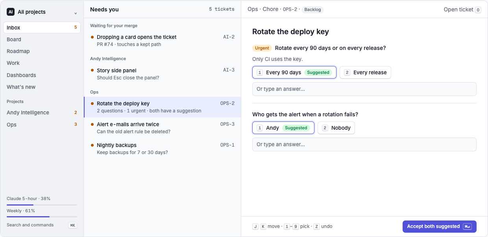
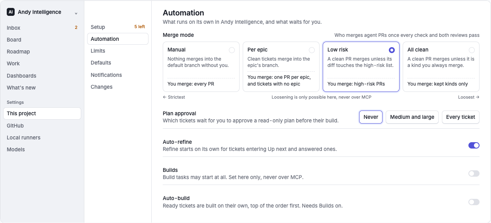

# 2026-11-23 — AI-357: Design and UX: a best-in-class UI across the whole system (review and proposal)

Andy asked for "an elite designed UI" and chose to approve mockups before anything is built. This entry is the review, the direction he picked, and the tickets. No product code changed.

**Outcome:** Andy approved direction A ("Instrument") with ideas from direction B for onboarding and workflows, design system first, all of it in tonight's work. Fourteen tickets sit under epic AI-357, in Ideas. The epic is on a new milestone, M11: Design system and UI rebuild, which is `not_reviewed` until Andy approves it on the roadmap.

## How it ran

A throwaway Playwright spec (not committed) rendered 27 screens at 1280×800 and 390×844, in light and dark, against the seeded fake API in `apps/web/e2e/fake-api.ts`, using the system Chrome. That is 198 images; production was never touched.

**Not verified:** behaviour after a click (answering, saving, dragging); GitHub and Local runners beyond their error state; real data volumes. The mockups are static HTML, not built components.

## What the review found

The 2026-11-21 review (AI-322) removed clutter and fixed the phone. What is left is the stock shadcn look.

| Area       | Finding                                                                                                                                                                                               |
| ---------- | ----------------------------------------------------------------------------------------------------------------------------------------------------------------------------------------------------- |
| Type       | System font, four sizes, the largest 18 px. A page title and a section heading look alike.                                                                                                            |
| Colour     | Every neutral is pure grey and the one action colour is black. Status tints work.                                                                                                                     |
| Surfaces   | Everything is a white box with a 1 px border; nothing is raised, sunken or selected.                                                                                                                  |
| Width      | Inbox cards span 1,350 px with content ending at 650. Project settings is 1,750 px tall in a 620 px column.                                                                                           |
| Feedback   | Nothing moves. An answered card disappears; a save shows grey "Saved" text. No toast, no skeleton.                                                                                                    |
| Pickers    | Every picker is a native select showing raw values (`low-risk`, `none`); only the picked option is explained. Switches are 13 px native checkboxes.                                                   |
| Components | Six primitives in `apps/web/src/components/ui/`, so pages hand-roll the rest.                                                                                                                         |
| Keyboard   | Shortcuts exist (AI-338) but no control shows its key, and there is no command palette.                                                                                                               |
| Dark mode  | Follows the operating system only; native checkboxes stay white.                                                                                                                                      |
| Flow       | New idea to merged work crosses Settings, Roadmap, Board and Inbox with no guide. Add project is three fields; the brief has no form (MCP `submit_brief` only); the plan to approve sits in settings. |
| Agent task | Five lines of text while a task runs.                                                                                                                                                                 |

Evidence: [inbox](assets/2026-11-23-design-review/shots/inbox.png), [project settings](assets/2026-11-23-design-review/shots/settings.png), [add project](assets/2026-11-23-design-review/shots/new-project.png), [models](assets/2026-11-23-design-review/shots/models.png), [board, dark](assets/2026-11-23-design-review/shots/board-dark.png), [agent task](assets/2026-11-23-design-review/shots/agent-task.png).

### Rules in `apps/web/design.md` to change

| Rule today                                         | Change to                                                                                                           |
| -------------------------------------------------- | ------------------------------------------------------------------------------------------------------------------- |
| "Nothing animates."                                | Motion explains a change: 120 to 180 ms, opacity and transform only, off under reduced motion, never delays input.  |
| System font, four sizes, nothing above `text-lg`.  | One chosen face plus a mono for keys and numbers; a six-step scale.                                                 |
| Eight colour roles, grey neutrals.                 | Add surface levels (sunken, base, raised), a selected state and an accent that is not black.                        |
| "Content is full width"; forms cap at `max-w-2xl`. | Three page templates: list with detail, settings with section navigation, reading page.                             |
| Components: Button, Badge, DropdownMenu.           | Name the full set; no native select or checkbox; a picker with fewer than six options shows all, with descriptions. |
| Dark mode from the operating system.               | A switch: system, light, dark.                                                                                      |
| No rule for feedback.                              | Every write confirms where it happened; a toast offers Undo when the write can be reversed.                         |

Kept: density, sentence case, role colours as tints, status visible without opening anything, the copy rules. The rewrite is ticket AI-367 and needs a new ADR.

Reference bar: Linear (a dense tracker driven from the keyboard), the Vercel dashboard (settings that show every option with a description), Superhuman (triage as a flow with Undo).

## Directions shown

Three directions, each mocked for the Needs-you inbox and Project settings. Open [`mockups.html`](assets/2026-11-23-design-review/mockups.html) in a browser for all six in light and dark. Its last section is the proposal as first shown to Andy; the ticket list below replaces it.

| Direction     | What it is                                                       | Verdict                                                  |
| ------------- | ---------------------------------------------------------------- | -------------------------------------------------------- |
| A: Instrument | Sidebar, list beside detail, indigo accent, Inter 13 px          | **Picked.**                                              |
| B: Focus      | One decision at a time in a centred column                       | Its card is used for onboarding, workflows and the phone |
| C: Console    | Top tabs, dense table, answers in the row; merge mode as a table | Not picked; its comparison table stays a picker variant  |

Direction A, Needs-you inbox:

Direction A, Project settings with the merge-mode picker:

Dark: [inbox](assets/2026-11-23-design-review/mockup-a-inbox-dark.png), [settings](assets/2026-11-23-design-review/mockup-a-settings-dark.png). Not picked: B [inbox](assets/2026-11-23-design-review/mockup-b-inbox.png), [settings](assets/2026-11-23-design-review/mockup-b-settings.png); C [inbox](assets/2026-11-23-design-review/mockup-c-inbox.png), [settings](assets/2026-11-23-design-review/mockup-c-settings.png).

## Before and after screenshots on UI PRs

Proposed for AI-353: UI PRs show before and after screenshots, and written into the ticket. The stored images are committed and the repo is public, so both versions of a changed image already have a URL. A script writes a "Before and after" table into the PR description; the existing release-note check fails a PR that changes a stored image without it. No new workflow permission is needed; the workflow edit is still Andy's to merge (ADR-0120). Coverage is widened first (AI-366), because a screen with no stored image has no "before".

## Tickets

All under epic AI-357, in Ideas, in build order. Every screen ticket starts with a mockup Andy approves, except the two already approved above.

| #   | Ticket                                                                                               | Size | Risk   | Blocked by       |
| --- | ---------------------------------------------------------------------------------------------------- | ---- | ------ | ---------------- |
| 1   | AI-366: Screenshot coverage: every screen at desktop and phone, dark for four                        | S    | Low    |                  |
| 2   | AI-353: UI PRs show before and after screenshots                                                     | M    | Medium | AI-366           |
| 3   | AI-367: Design direction A: tokens, type scale, surfaces, motion and theme switch; rewrite design.md | M    | Low    |                  |
| 4   | AI-368: Form components: select, option cards, switch, checkbox, field and tabs                      | M    | Low    | AI-367           |
| 5   | AI-369: Feedback components: toast with Undo, dialog, tooltip, skeleton, empty state and key hint    | M    | Low    | AI-367           |
| 6   | AI-370: Shell: sidebar navigation, quota meter and command palette                                   | M    | Low    | AI-367 to AI-369 |
| 7   | AI-371: Needs-you inbox: list beside detail, a key on every answer, Undo after each                  | M    | Low    | AI-370           |
| 8   | AI-372: Project settings: section navigation; every picker shows all options with descriptions       | M    | Low    | AI-370           |
| 9   | AI-373: New project to first build: create, brief, plan and approve milestones as one path           | L    | Medium | AI-370           |
| 10  | AI-374: Board and cards on the new design                                                            | M    | Low    | AI-370           |
| 11  | AI-375: Ticket and epic panel on the new design                                                      | M    | Low    | AI-370           |
| 12  | AI-376: Models: routing editor with named tiers, described options and one save model                | M    | Low    | AI-370           |
| 13  | AI-377: Agent task page: live progress, log and outcome                                              | M    | Low    | AI-370           |
| 14  | AI-378: Roadmap, Work, What's new, Dashboards, GitHub and Local runners on the new design            | M    | Low    | AI-370           |
| 15  | AI-379: Phone pass: every rebuilt screen at 390 px                                                   | M    | Low    | AI-371 to AI-378 |

Risk is this review's estimate; the tickets' own risk scores are not set. AI-353 is medium because it changes what judges a PR. AI-373 is medium because the web API may need a brief route.

## Approved mockups for the remaining screens

Andy approved these on 2026-11-23, all in direction A. A build matches its mockup's layout, components and hierarchy; the copy in them is placeholder where noted. All thirteen in light and dark: [`screens.html`](assets/2026-11-23-design-review/screens.html).

| Ticket                                                                                     | Mockup                                                                                                                                                                                                                                                                                                                                 |
| ------------------------------------------------------------------------------------------ | -------------------------------------------------------------------------------------------------------------------------------------------------------------------------------------------------------------------------------------------------------------------------------------------------------------------------------------- |
| AI-370: Shell: sidebar navigation, quota meter and command palette                         | [shell](assets/2026-11-23-design-review/screen-shell.png)                                                                                                                                                                                                                                                                              |
| AI-373: New project to first build: create, brief, plan and approve milestones as one path | [brief step](assets/2026-11-23-design-review/screen-onboard-brief.png), [approve step](assets/2026-11-23-design-review/screen-onboard-approve.png)                                                                                                                                                                                     |
| AI-374: Board and cards on the new design                                                  | [board](assets/2026-11-23-design-review/screen-board.png)                                                                                                                                                                                                                                                                              |
| AI-375: Ticket and epic panel on the new design                                            | [ticket panel](assets/2026-11-23-design-review/screen-ticket.png)                                                                                                                                                                                                                                                                      |
| AI-376: Models: routing editor with named tiers, described options and one save model      | [models](assets/2026-11-23-design-review/screen-models.png)                                                                                                                                                                                                                                                                            |
| AI-377: Agent task page: live progress, log and outcome                                    | [agent task](assets/2026-11-23-design-review/screen-agent-task.png)                                                                                                                                                                                                                                                                    |
| AI-378: Roadmap, Work, What's new, Dashboards, GitHub and Local runners on the new design  | [roadmap](assets/2026-11-23-design-review/screen-roadmap.png), [work](assets/2026-11-23-design-review/screen-work.png), [what's new](assets/2026-11-23-design-review/screen-whats-new.png), [dashboards](assets/2026-11-23-design-review/screen-dashboards.png), [connections](assets/2026-11-23-design-review/screen-connections.png) |
| AI-379: Phone pass: every rebuilt screen at 390 px                                         | [phone](assets/2026-11-23-design-review/screen-phone.png)                                                                                                                                                                                                                                                                              |

Limits of these mockups:

- Placeholder copy: tier descriptions, quota percentages, the agent task's timeline steps and the "Trail Log" project.
- AI-377: whether the API returns timeline steps was not checked; if not, the ticket needs an API change or a simpler timeline.
- Not drawn: the epic panel (it follows the ticket panel), steps 1, 3 and 5 of the new-project path, and phone versions of Models, Roadmap, Work, What's new and Dashboards (they follow the phone frames' pattern).

## Open

- M11: Design system and UI rebuild is `not_reviewed`: Andy approves or parks it on the roadmap. ARCHITECTURE §12 and `docs/architecture/milestones.md` do not list it yet; that row goes in with the ADR for AI-367.
- AI-353 for private managed projects: raw image URLs do not work there; refine settles the source.
- `docs/build-log.md` is unchanged by this entry.
